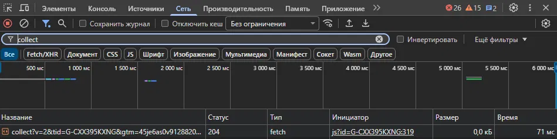
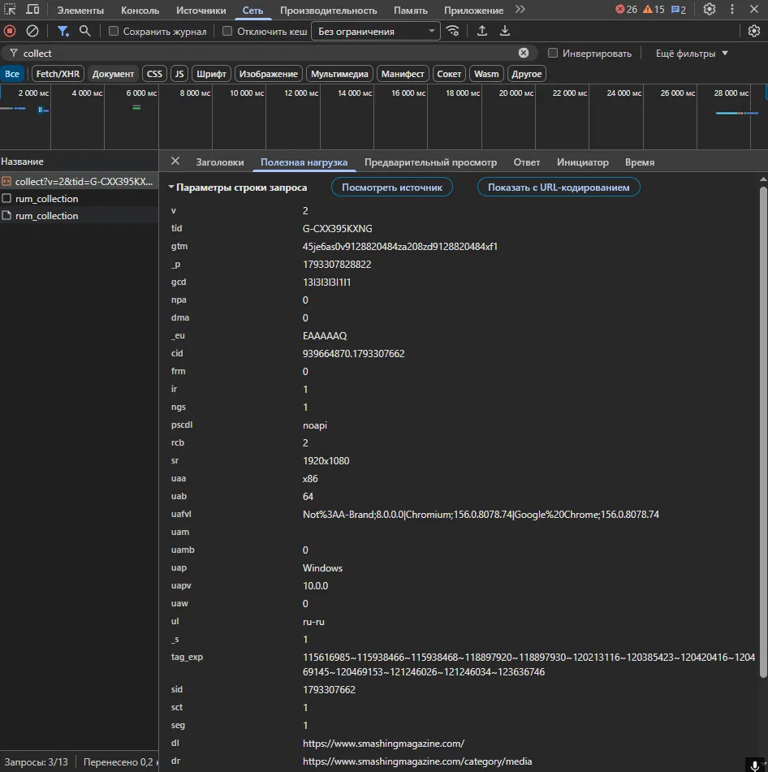

# Домашняя работа № 1 · Путь данных от ссылки до заявки

**Дисциплина:** ОП.03 «Информационные технологии»

| Поле | Значение |
|---|---|
| Фамилия, имя, отчество | Лийваку Александр Дмитриевич |
| Группа | ВПИШИТЕ |
| Номер работы | 1 |
| Тема работы | Цифровая воронка: путь данных от ссылки до заявки |
| Дата сдачи | ВПИШИТЕ |

---

## 1. Какой сайт смотрел

| Поле | Значение |
|---|---|
| Название сайта | ВПИШИТЕ (например, Google Merch Shop) |
| Адрес | ВПИШИТЕ (например, https://shop.merch.google/) |
| Откуда сайт | из списка в задании |

## 2. Три действия и что отправил счётчик

Заполняется только по тому, что вы реально увидели в панели Network
(фильтр `collect`, галочка Preserve log, вкладка Payload).

| № | Что я сделал на сайте | Название события (`en`) | Что ещё было в Payload |
|---|---|---|---|
| 1 | обновил страницу | ВПИШИТЕ | ВПИШИТЕ |
| 2 | прокрутил до низа | ВПИШИТЕ | ВПИШИТЕ |
| 3 | нажал на товар (или на ссылку) | ВПИШИТЕ | ВПИШИТЕ |

## 3. Путь пользователя: 5 шагов

| № | Мой шаг |
|---|---|
| 1 | Человек увидел ссылку на магазин в соцсети или рекламе и нажал на неё |
| 2 | Открылась главная страница магазина, счётчик отправил первое событие |
| 3 | Он прокрутил страницу, посмотрел каталог и открыл карточку понравившегося товара |
| 4 | Добавил товар в корзину и начал оформление: указал имя, адрес и контакты |
| 5 | Нажал «Оплатить» или «Оформить заказ», заказ ушёл в магазин и попал в статистику |

## 4. Где данные могут потеряться

| № | На каком шаге | Что может потеряться |
|---|---|---|
| 1 | шаг 1, переход по ссылке | в ссылке нет метки (UTM), поэтому в статистике и в заказе не видно, из какой рекламы или поста пришёл человек |
| 2 | шаг 2, открытие страницы (по желанию) | блокировщик рекламы или отказ от cookie не пропускает запрос `collect`, и посещение вообще не попадает в аналитику |

## 5. Использование ИИ

| Вопрос | Ответ |
|---|---|
| Что сделал сам | ВПИШИТЕ честно |
| Что спросил у модели | ВПИШИТЕ честно |
| Что после этого изменил | ВПИШИТЕ честно |
