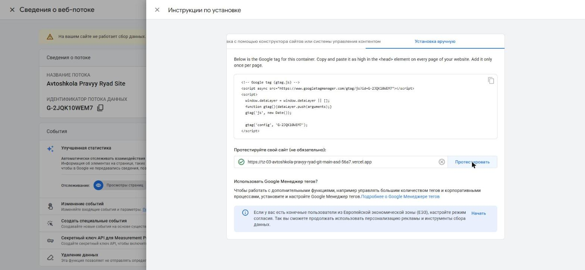
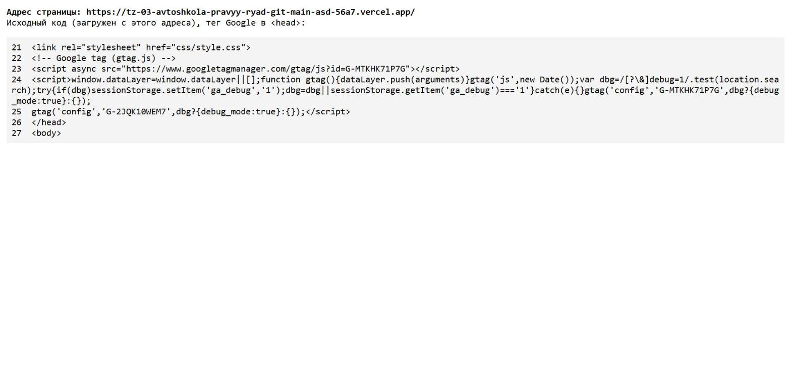
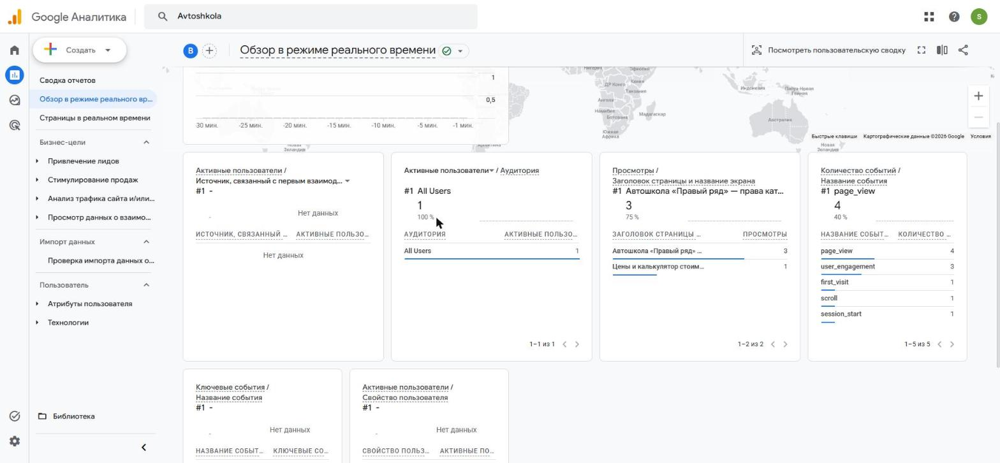
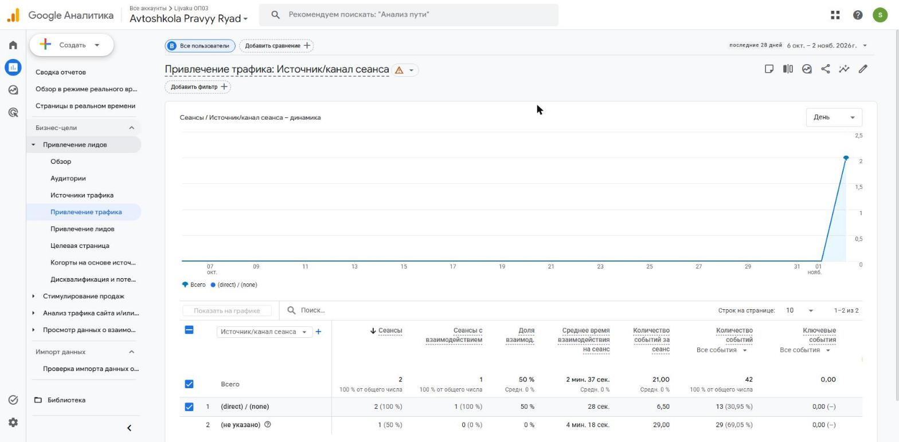
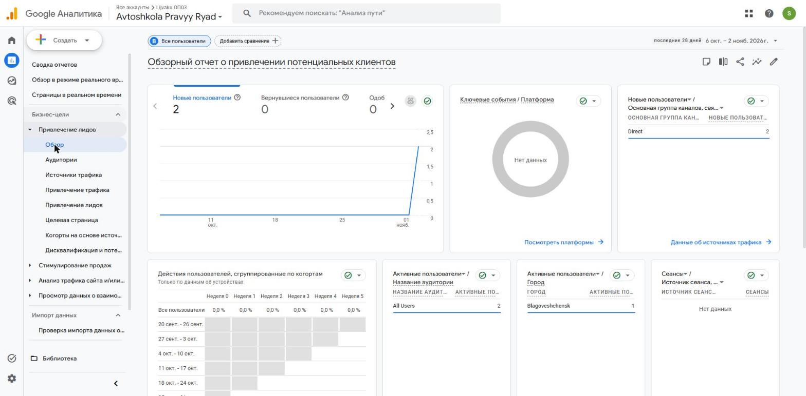

# Домашняя работа № 3 · Тег на сайте, источник и отчёты GA4

**Дисциплина:** ОП.03 «Информационные технологии»

| Поле | Значение |
|---|---|
| Фамилия, имя, отчество | Лийваку Александр Дмитриевич |
| Группа | РПО 11/1 |
| Номер работы | 3 |
| Тема работы | Установка Google Tag, источник перехода и отчёты GA4 |
| Дата сдачи | ВПИШИТЕ |

---

## 1. Мой сайт и мой ресурс

| Поле | Значение |
|---|---|
| Адрес репозитория сайта | https://github.com/kxzyan/tz-03-avtoshkola-pravyy-ryad |
| Публичный адрес сайта | https://tz-03-avtoshkola-pravyy-ryad-git-main-asd-56a7.vercel.app |
| Статус публикации | READY |
| Analytics Account | Lijvaku ОП03 |
| Property | Avtoshkola Pravyy Ryad |
| Stream name | Avtoshkola Pravyy Ryad Site |
| Website URL в потоке | https://tz-03-avtoshkola-pravyy-ryad-git-main-asd-56a7.vercel.app |
| Measurement ID (`G-…`) | G-2JQK10WEM7 |
| Страницы с тегом | все 9 страниц: index, prices, instructors, branches, contacts, pdd-test, privacy, thanks, 404 |

Тег ставится на каждую страницу по одному разу: две копии дают двойные
события.

На сайте уже стоял тег Google с идентификатором прежнего ресурса `G-MTKHK71P7G`. Чтобы не ломать прежнюю работу, он оставлен, а в тот же блок в `<head>` добавлена строка `gtag('config','G-2JQK10WEM7')`. Скрипт `gtag.js` на странице один, события уходят в оба ресурса. Коммит в репозитории сайта: `92598d9`.

## 2. Тег установлен

**Результат проверки из инструкции тега:**

> В «Сведения о веб-потоке → Просмотр инструкций тега → Установка вручную» кнопка «Протестировать» для адреса сайта показала зелёную галочку. Текст «обнаружен тег Google» Google не вывел. Предупреждение «Данные не получены» в самом потоке на момент проверки ещё не обновилось: статус потока меняется с задержкой.





На кадре 2 показан код из `<head>` опубликованной страницы, полученный запросом с адреса сайта (просмотр исходника в браузере был недоступен). Строка 25 содержит `G-2JQK10WEM7`.

## 3. События доходят до аналитики

| Поле | Значение |
|---|---|
| Дата и время проверки | 02.11.2026, вечер |
| Какие страницы открывали | главная (по ссылке с UTM, см. раздел 4) и `prices.html` |
| Какие события появились в Realtime | `page_view` (4), `user_engagement` (3), `first_visit` (1), `scroll` (1), `session_start` (1) |
| Число активных пользователей в момент проверки | 1 |



## 4. Источник перехода определился

Ссылка собирается с метками `utm_source`, `utm_medium`, `utm_campaign`
и открывается на своём сайте.

**Ссылка целиком:**

```
https://tz-03-avtoshkola-pravyy-ryad-git-main-asd-56a7.vercel.app/?utm_source=telegram&utm_medium=social&utm_campaign=hw03_test
```

| Поле | Значение |
|---|---|
| Где в GA4 виден источник | Отчёты → Привлечение лидов → Привлечение трафика, измерение «Источник/канал сеанса» |
| Какое значение источника показал GA4 | `(direct) / (none)` (2 сеанса) и `(не указано)` (1 сеанс); `telegram` в отчёте пока нет |
| Совпадает с `utm_source` из ссылки | нет (на 03.11.2026 визит по UTM-ссылке ещё не отобразился, см. раздел 6) |



Источник и кампания из UTM в отчёте Realtime не показываются: эти измерения
вычисляются при обработке данных. Если в Realtime источника нет, смотрите
отчёт по источникам трафика в разделе «Отчёты».

## 5. Статистика на странице «Отчёты»

| Показатель | Значение | Период |
|---|---|---|
| Пользователи | 2 | 6 окт. – 2 нояб. 2026 |
| Сеансы | 2 | 6 окт. – 2 нояб. 2026 |
| События | 42 | 6 окт. – 2 нояб. 2026 |
| Самое частое событие | `page_view` (по Realtime) | 02.11.2026 |



**Что видно по этим числам** (2–3 предложения):

> Сайт отправляет данные: за период в ресурсе 2 пользователя (оба новые, канал Direct) и 42 события. Сеансов всего 2, поэтому выводы о трафике делать рано. Данные идут только с 02.11.2026: раньше сайт в этот ресурс ничего не отправлял.

## 6. Что не получилось

Если какой-то шаг не заработал, напишите какой, какое сообщение показал сервис
и что было проверено по таблице из `README.md`. Незаполненный раздел означает,
что всё получилось.

> Источник `telegram` из UTM-ссылки в отчёте «Привлечение трафика» пока не появился: на 03.11.2026 там только `(direct) / (none)` и `(не указано)`. Realtime источник не показывает; в отчётах данные появляются в течение суток. Кадр 4 снят с тем, что показывает GA4 на сегодня, подменять значение не стал. Возможно, визит по ссылке ушёл в прежний ресурс `G-MTKHK71P7G`.

## 7. Использование ИИ

Тег вы устанавливаете, проверяете и снимаете кадры сами. ИИ допускается
для формулировок и оформления.

| Вопрос | Ответ |
|---|---|
| Что сделано самостоятельно |  |
| Что спрошено у модели |  |
| Что после этого изменено |  |
