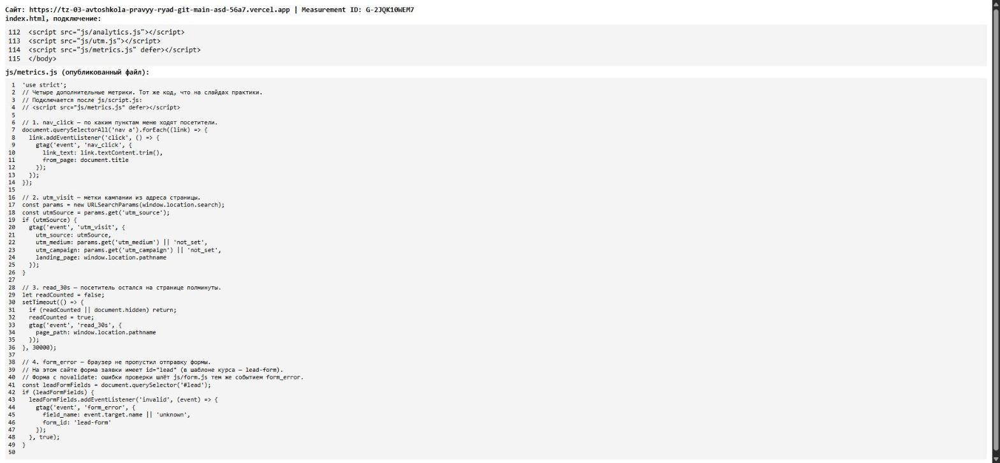
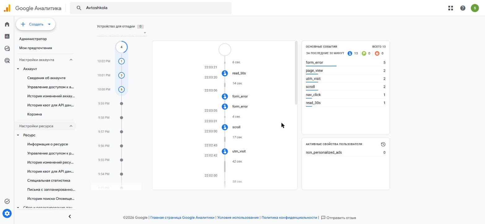
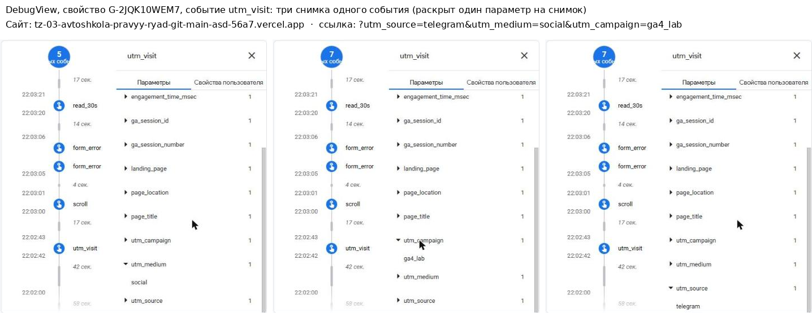
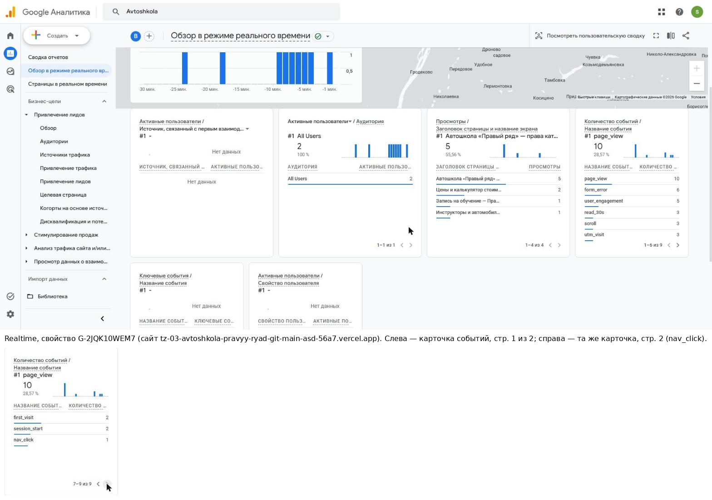

# Домашняя работа № 4 · Свои события и параметры в GA4

**Дисциплина:** ОП.03 «Информационные технологии»

| Поле | Значение |
|---|---|
| Фамилия, имя, отчество | Лийваку Александр Дмитриевич |
| Группа | РПО 11/1 |
| Номер работы | 4 |
| Тема работы | Свои события и параметры: четыре метрики на сайте |
| Дата сдачи | ВПИШИТЕ |

---

## 1. Мой сайт и мой ресурс

| Поле | Значение |
|---|---|
| Публичный адрес сайта | https://tz-03-avtoshkola-pravyy-ryad-git-main-asd-56a7.vercel.app |
| Measurement ID (`G-…`) | G-2JQK10WEM7 |
| Коммит с метриками (ссылка или первые 7 символов) | 90dbeb4 (репозиторий сайта `kxzyan/tz-03-avtoshkola-pravyy-ryad`) |
| Статус публикации | READY |
| Страницы, где подключён `js/metrics.js` | все 9: index, prices, instructors, branches, contacts, pdd-test, privacy, thanks, 404 |

Файл подключается после основного скрипта и на каждой странице по одному
разу: два подключения дают двойные события.

Файл взят готовым из материалов темы 6. Изменена одна строка: форма заявки на моём сайте имеет `id="lead"` (в шаблоне курса — `lead-form`), поэтому селектор заменён на `#lead`. Эта форма с `novalidate`, браузерное событие `invalid` на ней не возникает, а ошибки проверки уже отправляет `js/form.js` тем же событием `form_error` (параметры `field_name`, `error_type`). Двойных событий нет.

## 2. Какие метрики добавлены

| Событие | Что измеряет | Что делали, чтобы оно сработало |
|---|---|---|
| `nav_click` | клики по пунктам меню | нажал пункт меню «Инструкторы» с зажатым Ctrl, чтобы страница не закрылась до отправки события |
| `utm_visit` | метки кампании из адреса | открыл сайт по ссылке с метками (см. раздел 4) |
| `read_30s` | полминуты на странице | остался на странице больше 30 секунд, вкладка была активна |
| `form_error` | форма не прошла проверку браузера | на странице записи нажал «Отправить заявку» с пустыми полями (проверка остановила отправку, заявка не ушла) |



На кадре — опубликованный файл и строка подключения из `index.html`, полученные запросом с адреса сайта (просмотр исходника в браузере был недоступен).

## 3. События в DebugView

| Поле | Значение |
|---|---|
| Дата и время проверки | 02.11.2026, 22:00–22:06 (МСК) |
| Как подключали отладку | `debug_mode` (сайт включает его при открытии с `?debug=1`) |
| Какие из четырёх событий пришли | все четыре: `utm_visit`, `nav_click`, `read_30s`, `form_error` |
| Какие не пришли и почему | см. раздел 7: `nav_click` при обычном клике с переходом не пришёл, пришёл при клике с Ctrl |



## 4. Параметры события `utm_visit`

**Ссылка, по которой открывали сайт:**

```
https://tz-03-avtoshkola-pravyy-ryad-git-main-asd-56a7.vercel.app/?utm_source=telegram&utm_medium=social&utm_campaign=ga4_lab&debug=1
```

К ссылке добавлен `debug=1` только для включения DebugView.

| Параметр | Значение в ссылке | Значение в GA4 |
|---|---|---|
| `utm_source` | telegram | telegram |
| `utm_medium` | social | social |
| `utm_campaign` | ga4_lab | ga4_lab |
| `landing_page` | — | / |



Панель DebugView раскрывает только один параметр за раз, поэтому кадр 3 составлен из трёх снимков одного события `utm_visit` (по одному раскрытому параметру), подпись добавлена мной.

Если значение в GA4 отличается от значения в ссылке, напишите, в чём разница
и почему так вышло.

> Значения совпали с ссылкой. `landing_page` равен `/`, потому что скрипт передаёт `window.location.pathname` (путь без домена и меток).

## 5. Событие вне отладки

| Поле | Значение |
|---|---|
| Где проверяли | Realtime |
| Какое событие искали | все четыре новых: `nav_click`, `utm_visit`, `read_30s`, `form_error` |
| Сколько срабатываний показал экран | `form_error` — 6, `read_30s` — 3, `utm_visit` — 3, `nav_click` — 1 |
| Период (для отчёта) | последние 30 минут (Realtime) |



Карточка событий в Realtime показывает по 6 строк, поэтому на кадре 4 первая страница (с `form_error`, `read_30s`, `utm_visit`) и вторая страница (с `nav_click`) вынесены отдельным фрагментом. Отчёт «События» за период пока не проверялся: данные в нём появляются в течение суток.

## 6. Что эти метрики показывают про сайт

Два-три предложения: что вы узнали о поведении посетителей из четырёх
новых событий. Например, по каким пунктам меню ходят чаще, доходит ли
кто-то до получаса чтения, спотыкается ли форма.

> Это мои тестовые визиты, поэтому о реальных посетителях выводов делать нельзя. Метрики показали, что сайт фиксирует: приход по размеченной ссылке (`utm_visit`: telegram / social / ga4_lab), клик по пункту меню (`nav_click`), задержку на странице 30 секунд (`read_30s`) и ошибки заполнения формы (`form_error`: при пустой форме 3 ошибки за одну отправку, по полям имя, телефон и согласие). Когда на сайт придут реальные посетители, по этим событиям можно будет увидеть популярные пункты меню и где форма заявки чаще всего не проходит проверку.

## 7. Что не получилось

Если какая-то метрика не заработала, напишите какая, что показывал экран
и что было проверено по таблице из `README.md`. Незаполненный раздел
означает, что всё получилось.

> `nav_click`: при обычном клике по пункту меню, который сразу открывает другую страницу, событие в DebugView не появилось (в ленте был только `page_view` новой страницы). Событие пришло, когда я кликнул по пункту с зажатым Ctrl (страница осталась открытой). Это совпадает с подсказкой из `README.md`: событие уходит при переходе и может теряться. `read_30s`: в первой попытке не пришло, вероятно потому, что вкладка считалась неактивной в момент 30-й секунды (условие `document.hidden` в скрипте); при повторе с активной вкладкой пришло. DebugView показывал события с задержкой до минуты.

## 8. Использование ИИ

Скрипты метрик выданы готовыми. Подключение, проверку и кадры вы делаете
сами. ИИ допускается для формулировок и оформления.

| Вопрос | Ответ |
|---|---|
| Что сделано самостоятельно |  |
| Что спрошено у модели |  |
| Что после этого изменено |  |
