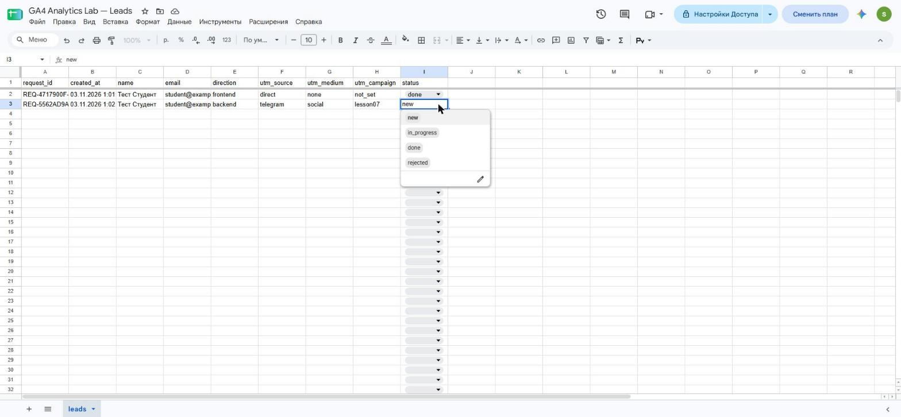
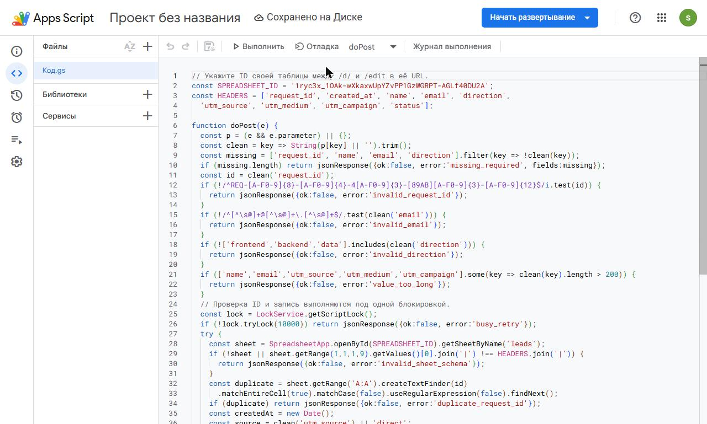
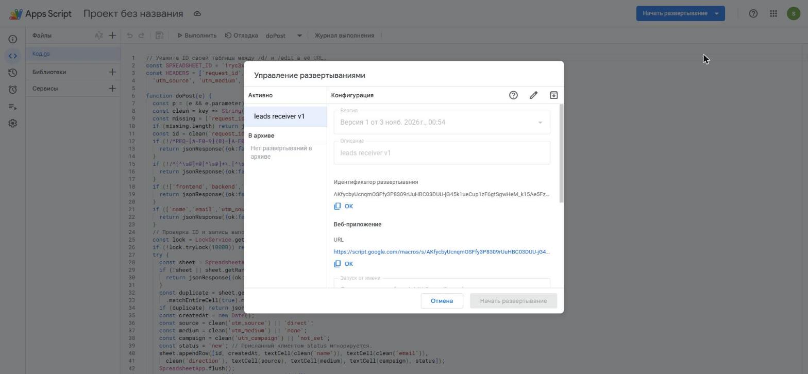
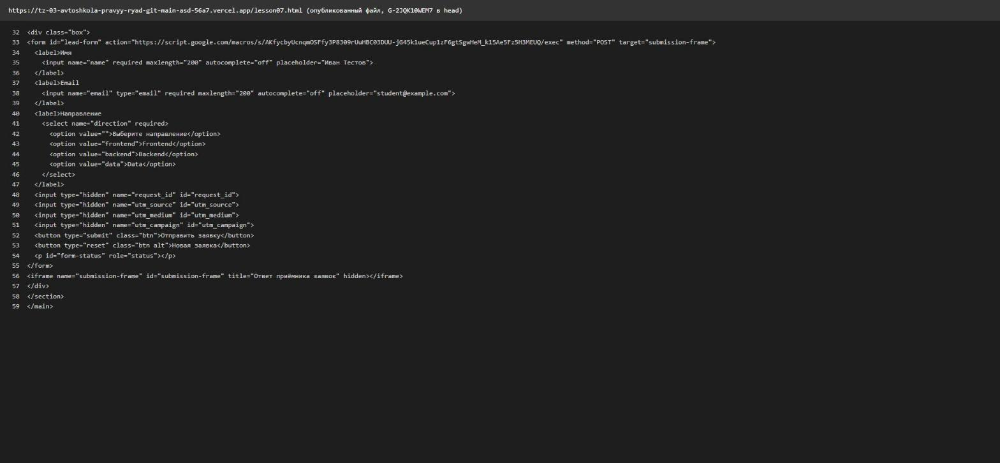
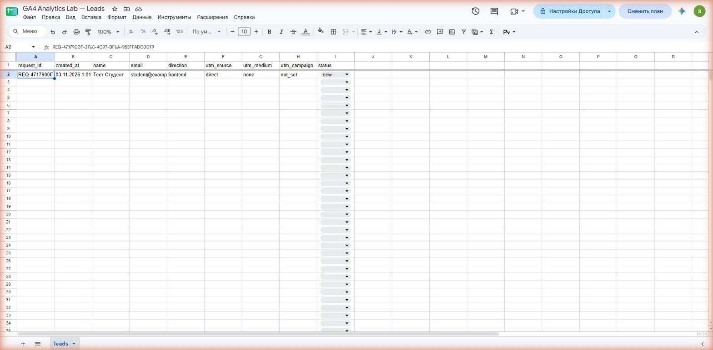
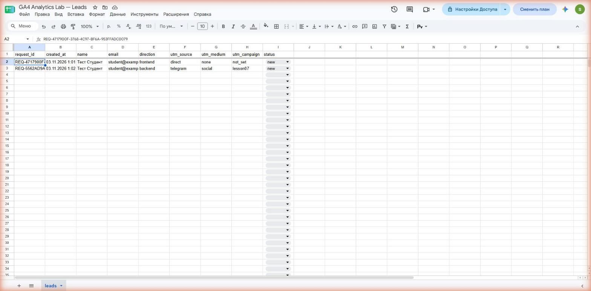
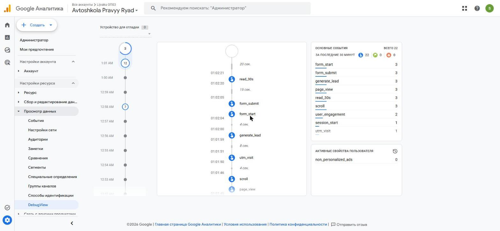
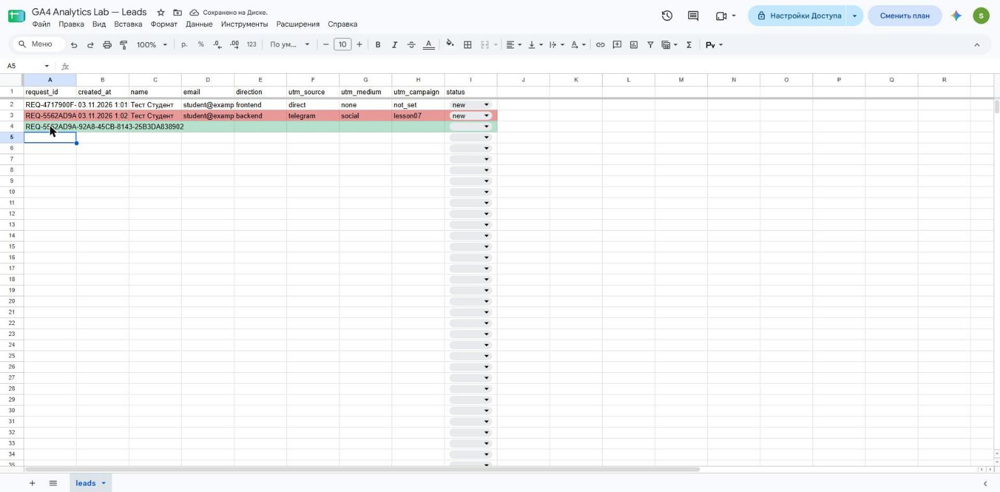
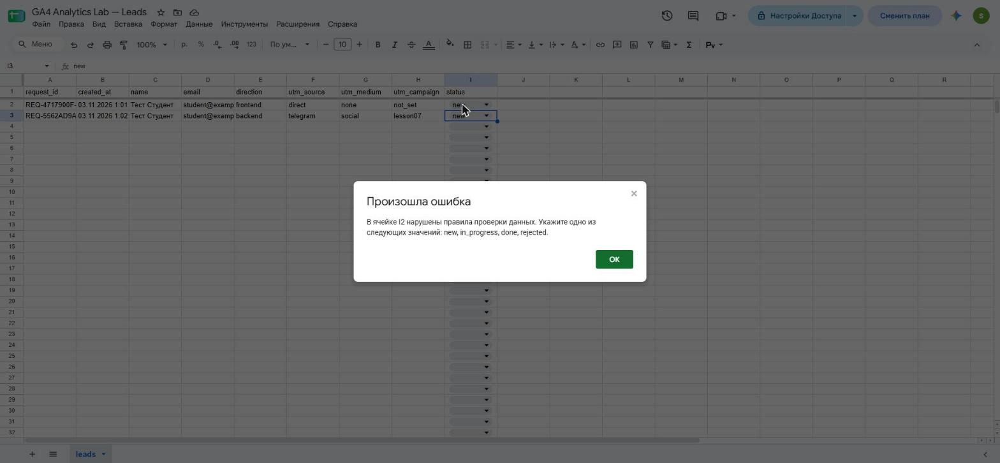

# Домашняя работа № 5 · Контролируемая таблица заявок

**Дисциплина:** ОП.03 «Информационные технологии»

| Поле | Значение |
|---|---|
| Фамилия, имя, отчество | Лийваку Александр Дмитриевич |
| Группа | РПО 11/1 |
| Номер работы | 5 |
| Тема работы | Форма сайта → Apps Script → Google Таблица заявок |
| Дата сдачи |  |

Текст ниже уже написан. Замените `___` своими данными и вставьте кадры
вместо строк «Скриншот: …».

---

## 1. Таблица

Я создал таблицу «GA4 Analytics Lab — Leads» с листом `leads`. В первой
строке девять заголовков: `request_id`, `created_at`, `name`, `email`,
`direction`, `utm_source`, `utm_medium`, `utm_campaign`, `status`. Строка
заголовков закреплена, у статуса список из четырёх значений: `new`,
`in_progress`, `done`, `rejected`. Два правила подсвечивают неполную строку
и повторный `request_id`.

Ссылка на таблицу (доступ открыт только преподавателю): https://docs.google.com/spreadsheets/d/1ryc3x_1OAk-wXkaxwUpYZvPP1GzWGRPT-AGLf40DU2A/edit

## 2. Приёмник и форма

Я вставил `Code.gs` из материалов в Apps Script, указал ID своей таблицы
и опубликовал проект как Web app (запуск от моего имени, доступ «Все»).
На моём сайте форма `contacts.html` уже работает с другим приёмником для
другого проекта, поэтому я не стал её заменять. Вместо этого фрагмент формы
из материалов и `lead-form.js` вынесены на отдельную страницу `lesson07.html`
(`js/lead-form.js`), в `action` стоит адрес моего Web app. Подробнее в
разделе «Не получилось».

| Мои данные | Значение |
|---|---|
| Публичный адрес сайта | https://tz-03-avtoshkola-pravyy-ryad-git-main-asd-56a7.vercel.app |
| Measurement ID (`G-…`) | G-2JQK10WEM7 |
| Коммит с новой формой (первые 7 символов) | 47cf25e (репозиторий сайта `kxzyan/tz-03-avtoshkola-pravyy-ryad`) |

На кадре — опубликованный файл `lesson07.html`, полученный запросом с адреса сайта (просмотр исходника в браузере был недоступен).

## 3. Две тестовые заявки

Первую заявку я отправил со страницы без меток (`lesson07.html`): в таблице записалось
`direct` / `none` / `not_set` и статус `new`. Вторую отправил по ссылке
`lesson07.html?utm_source=telegram&utm_medium=social&utm_campaign=lesson07`,
и метки записались в свои столбцы. В заявках вымышленные данные
(«Тест Студент», `student@example.com`).

| | Заявка без меток | Заявка с метками |
|---|---|---|
| `request_id` | REQ-4717900F-3768-4C97-BF6A-953FFADC0079 | REQ-5562AD9A-92A8-45CB-8143-25B3DA838902 |

## 4. Событие в аналитике

После отправки в GA4 пришло событие `generate_lead`. Оно показывает
попытку отправки формы, а сама заявка подтверждается строкой в таблице.

На кадре DebugView ресурса Avtoshkola Pravyy Ryad (Measurement ID `G-2JQK10WEM7`): `generate_lead` приходит вместе с отправкой форм. Сам ID на экране DebugView не показывается.

## 5. Проверки

Форма с пустым именем не отправилась (браузер останавливает отправку из-за `required`). Копия `request_id` во второй строке подсветила дубль,
после кадра я её удалил. Статус `finished` таблица не приняла,
а через список статус первой заявки сменился `new` → `in_progress` → `done`.
Повторную отправку без «Новая заявка» отдельно не проверял.

---

Не получилось (если всё работает, оставьте пустым): форма `contacts.html` на моём сайте уже отправляет заявки в другой Apps Script (другой проект), поэтому по заданию («заменить форму в `contacts.html`») я её не менял, а сделал отдельную страницу `lesson07.html`. Ссылка с метками ведёт на `lesson07.html`, а не на `contacts.html`. Первая попытка отправки не записалась: заголовки попали в одну ячейку A1, и приёмник вернул `invalid_sheet_schema`; после исправления заголовков по ячейкам обе заявки записались. Дубль в кадре 8 подсвечен красным у исходной строки (вторая строка сразу зелёная как неполная), так как правило неполной строки стоит выше. Повторную отправку без «Новая заявка» не проверял. Окно «Предоставить доступ» показывало старое состояние, развёртывание создалось, проверил через «Управление развертываниями».

ИИ: не использовал / использовал для ___
