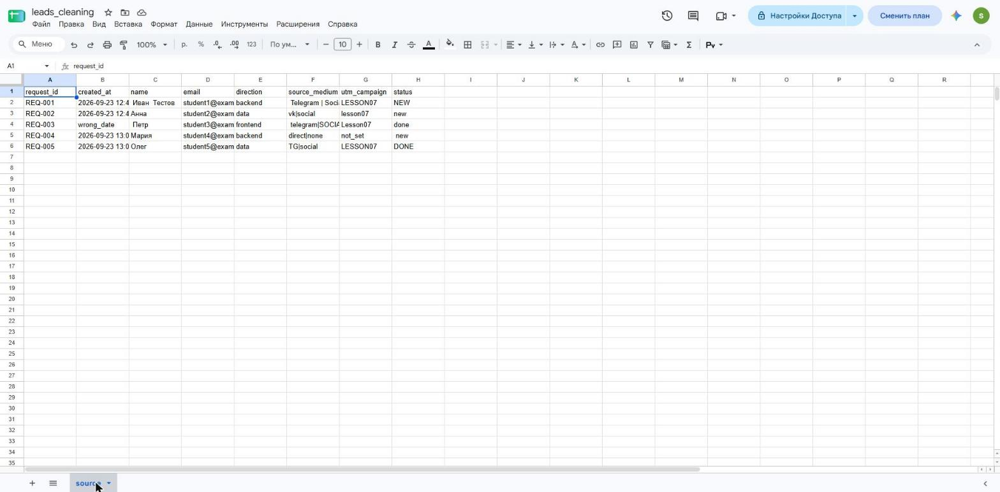
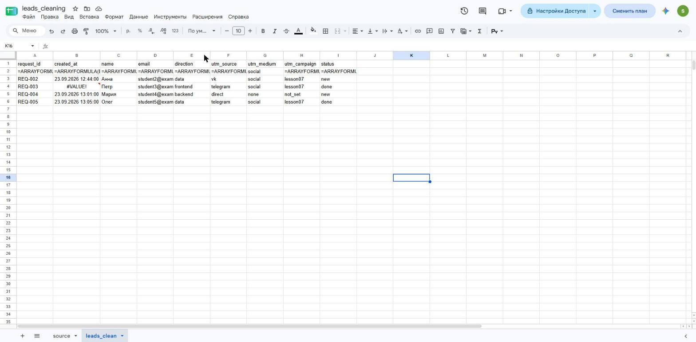
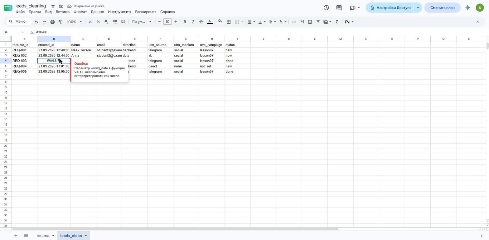
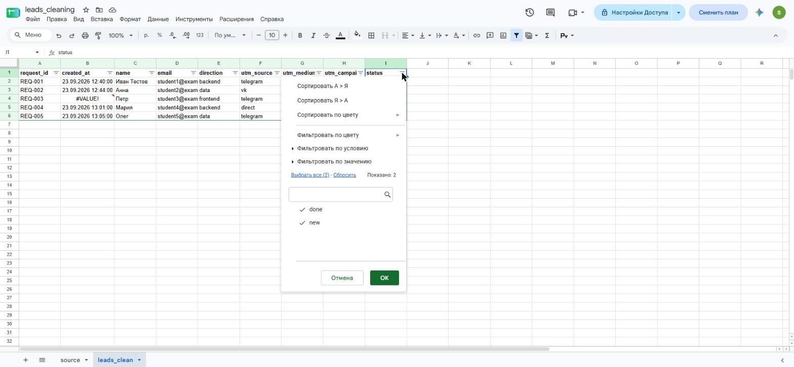
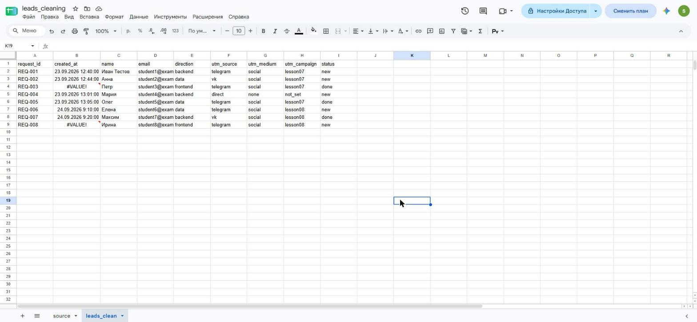
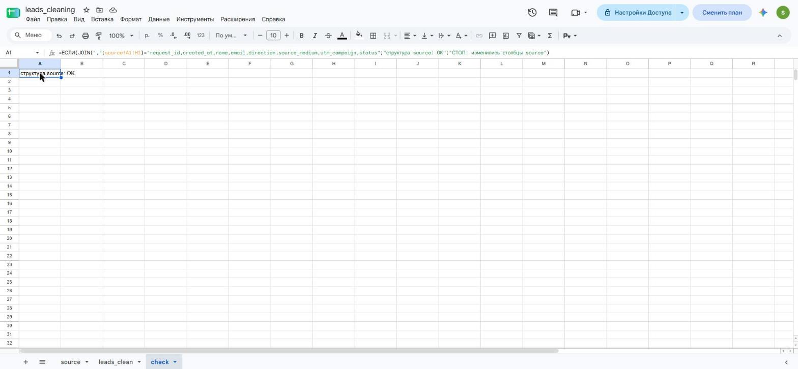

# Домашняя работа № 6 · Подготовка данных в Google Таблицах

**Дисциплина:** ОП.03 «Информационные технологии»

| Поле | Значение |
|---|---|
| Фамилия, имя, отчество | Лийваку Александр Дмитриевич |
| Группа | РПО 11/1 |
| Номер работы | 6 |
| Тема работы | Повторяемая очистка выгрузки заявок в Google Таблицах |
| Дата сдачи |  |

---

## 1. Импорт

Я создал таблицу `leads_cleaning` и загрузил `leads_dirty.csv` на лист `source`.
Данные остались текстом, как в файле, и я их не редактировал.

Ссылка на таблицу (доступ открыт только преподавателю): https://docs.google.com/spreadsheets/d/1ftU_t3ean6PDhpRgsUjTL0Q235iE0YapTzRD_BtJ-S0/edit

Кадра 01 (окно «Импорт файла») нет: окно импорта у меня не отрисовалось (белый экран), см. раздел «Не получилось».

## 2. Правила

На листе `leads_clean` девять заголовков, и в каждом столбце одна формула
ARRAYFORMULA во второй строке. Формулы убирают лишние пробелы, делят
`source_medium` на источник и канал, приводят метки и статус к нижнему
регистру и заменяют `tg` на `telegram`.

## 3. Ошибка и проверка значений

В строке `REQ-003` дата записана как `wrong_date`, поэтому в `created_at`
стоит `#VALUE!`. Я оставил ошибку видимой, чтобы не потерять неверную
запись. В фильтре `status` после очистки только `done` и `new`.

## 4. Вторая выгрузка

Я заменил данные на том же листе `source` содержимым `leads_dirty_v2.csv`. Формулы
не менял: в `leads_clean` стало 8 строк вместо 5, ошибочные даты видны
у `REQ-003` и `REQ-008`. Строка `REQ-006` очистилась в
Елена / telegram / social / lesson08 / new. Результат скачан и лежит
в этой папке как `leads_clean.csv`.

## 5. Проверка структуры

На листе `check` формула сравнивает заголовки `source` с ожидаемыми
и показывает «структура source: OK». Если столбцы в CSV переставят,
она покажет «СТОП: изменились столбцы source».

---

Не получилось: окно «Импорт файла» в Google Таблицах показывало белый экран, поэтому я открыл CSV через Google Диск (файл сразу стал таблицей `leads_dirty`, я переименовал её в `leads_cleaning`, лист назвал `source`). Вторую выгрузку я вставил на `source` как простой текст (формат «Обычный текст»), а не командой импорта. Файл `leads_clean.csv` собран по значениям листа `leads_clean` (те же 8 строк и `#VALUE!` у `REQ-003` и `REQ-008`), а не скачан через «Файл → Скачать».

ИИ: использовал Claude для настройки формул и работы с таблицей в браузере; результат проверил по экрану.
