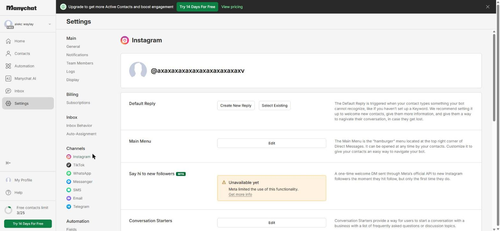
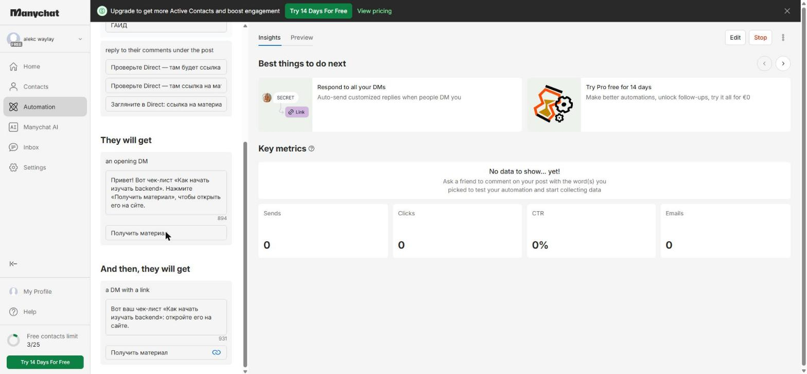
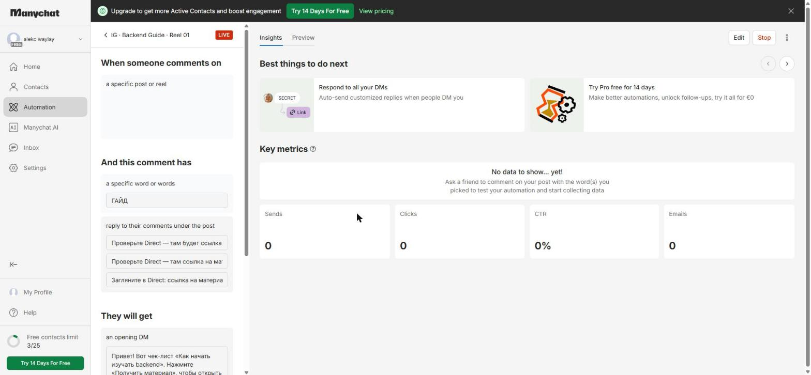
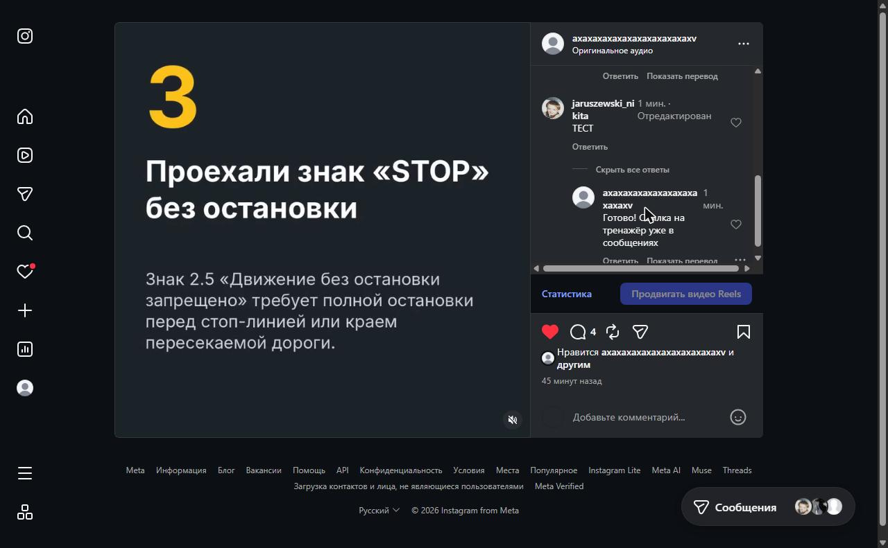

# Домашняя работа № 7 · Instagram → ManyChat → заявка

**Дисциплина:** ОП.03 «Информационные технологии»

| Поле | Значение |
|---|---|
| Фамилия, имя, отчество | Лийваку Александр Дмитриевич |
| Группа | РПО 11/1 |
| Номер работы | 7 |
| Тема работы | Автоворонка из Instagram: комментарий → сообщение → сайт → заявка |
| Дата сдачи |  |

---

## 1. Подключение и automation

Учебный аккаунт Instagram подключён к ManyChat на тарифе Free. Я собрал
automation `IG · Backend Guide · Reel 01`: триггер на комментарий под
выбранным рилсом, ключевое слово `ГАЙД`, публичный ответ, личное сообщение
с кнопкой «Получить материал» и второе сообщение с кнопкой-ссылкой
на `guide.html` с метками. Automation включена (Live).

| Мои данные | Значение |
|---|---|
| Учебный аккаунт Instagram | axaxaxaxaxaxaxaxaxaxaxaxv (как на кадре) |
| Ссылка на учебную публикацию |  |
| Публичный адрес сайта | https://tz-03-avtoshkola-pravyy-ryad-git-main-asd-56a7.vercel.app |
| Measurement ID (`G-…`) | G-2JQK10WEM7 |

## 2. Тест цепочки

Со второго аккаунта (`jaruszewski_nikita`) я оставил комментарий `ТЕСТ` под
учебным рилсом. Под ним появился автоматический ответ ManyChat
«Готово! Ссылка на тренажёр уже в сообщениях». Это проверка того, что триггер
на комментарий работает. Тест с ключевым словом `ГАЙД`, сообщением
в Direct и переходом на `guide.html` не проведён.

Кадра 06 нет. Страница `guide.html` опубликована на сайте, ссылка с метками: `…/guide.html?utm_source=instagram&utm_medium=social&utm_campaign=backend_guide&utm_content=reel01`.

## 3. Результат

Кадров GA4 (07) и строки заявки из этой воронки (08) нет: тестовая заявка
с `guide.html` не отправлялась.

---

Не получилось: тест цепочки с `ГАЙД` (комментарий, сообщение в Direct, переход на `guide.html`, заявка) пока не проведён, поэтому нет кадров 06, 07, 08. Кадр 04 снят с ранее собранной воронки («ТЕСТ»). Конструктор ManyChat на тарифе Free делает два сообщения (открывающее с кнопкой и второе со ссылкой) вместо одного, а подпись под рилсом осталась старой, в ней нет призыва «ГАЙД». Файлы `guide.html` и `js/guide.js` добавлены в сайт, кнопка со страницы ведёт на `lesson07.html` (там рабочая форма из задания 5), а не на `contacts.html`.

ИИ: использовал Claude для добавления `guide.html`, сборки automation в ManyChat и оформления бланка.
